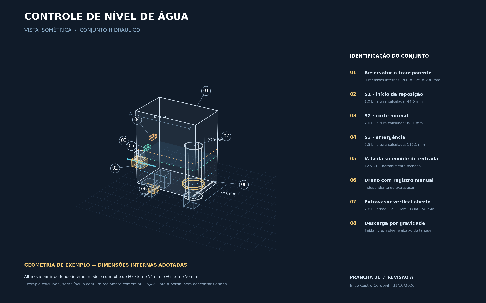
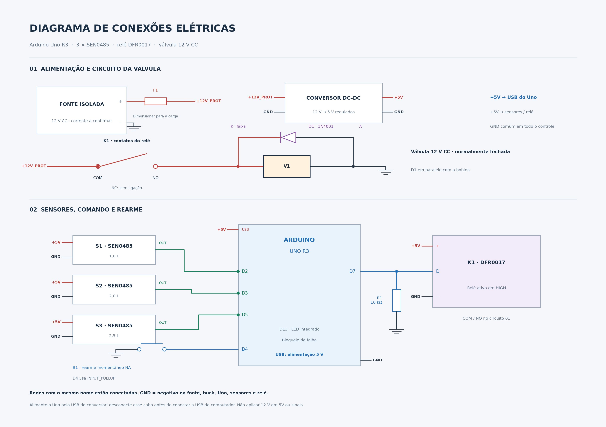

# Sistema de Controle Automático de Nível de Água com Arduino

Projeto de um sistema de controle automático de nível para um tanque de água, utilizando Arduino Uno, três sensores capacitivos e válvula solenoide. Inclui circuito elétrico, desenho 3D, dimensionamento hidráulico e código de controle com bloqueio persistente e rearme manual.




**Geometria de exemplo:** reservatório retangular com dimensões internas de **200 × 125 × 230 mm**, escolhidas para este projeto. O extravasor de referência tem 50 mm internos e 54 mm externos. As alturas calculadas consideram o volume ocupado pelo tubo; conexões e flanges adicionais não foram descontados.

| Referência | Volume | Altura calculada a partir do fundo interno |
|---|---:|---:|
| Sensor inferior | 1,0 L | 44,0 mm |
| Sensor superior | 2,0 L | 88,1 mm |
| Emergência | 2,5 L | 110,1 mm |
| Borda do extravasor | 2,8 L | 123,3 mm |

A capacidade geométrica líquida do exemplo é aproximadamente 5,47 L. O limite de 5 L continua sendo uma referência conservadora de cálculo. Os desenhos do conjunto hidráulico e do circuito elétrico estão disponíveis em PNG e SVG.

## Conexões elétricas



O esquema usa redes nomeadas: todos os pontos `+5V`, `+12V_PROT` ou `GND` com o mesmo nome pertencem à mesma conexão. Os blocos indicam funções e terminais; não reproduzem a posição física dos conectores. Consulte a [memória de cálculo e a tabela de ligações](docs/GEOMETRIA_E_CONEXOES.md).

## Funcionamento

A reposição começa abaixo do sensor inferior e termina ao atingir o superior. O sensor de emergência desliga o comando e bloqueia novas tentativas. Excesso de tempo ou sinais incompatíveis também provocam bloqueio, registrado na EEPROM e mantido após desligamento. O rearme depende de nova pressão do botão, emergência inativa e sinais coerentes.

| Função | Referência | Pino |
|---|---:|---|
| Iniciar reposição | 1 L | D2 |
| Encerrar reposição | 2 L | D3 |
| Emergência | 2,5 L | D5 |
| Botão de rearme | Normalmente aberto | D4 e GND |
| Comando do relé | Ativo em HIGH | D7 |
| Indicador de bloqueio | LED integrado | D13 |
| Borda do extravasor vertical aberto | 2,8 L | Sem comando elétrico |

Os sensores são ativos em LOW. Os volumes dependem da posição física dos sensores; o Arduino recebe sinais digitais e não mede litros diretamente. A supervisão usa 35 segundos por etapa, sob a premissa de ganho líquido mínimo de 2 L/min.

## Componentes de referência

- Arduino Uno R3 (ATmega328P).
- Três sensores capacitivos SEN0485.
- Módulo relé DFR0017 com comando ativo em HIGH.
- Válvula solenoide normalmente fechada de 12 V CC.
- Botão momentâneo, resistor de 10 kΩ e diodo 1N4001.
- Fonte isolada de 12 V e conversor regulado de 5 V, a confirmar conforme os consumos reais.
- Reservatório retangular de exemplo, dreno manual e extravasor vertical aberto de referência de 50 mm internos.

Confira alimentação, polaridade e montagem no [guia de montagem](LEIAME.md). A válvula é alimentada pelos contatos do relé; nunca por um pino do Arduino.

## Abrir no Arduino IDE

1. Baixe ou clone este repositório.
2. Abra [ControleNivel/ControleNivel.ino](ControleNivel/ControleNivel.ino).
3. Selecione Arduino Uno e a porta correspondente.
4. Compile o código e carregue na placa.

A biblioteca EEPROM faz parte do pacote Arduino AVR Boards. O Monitor Serial usa 9600 baud.

## Repetir as simulações

Requer g++ com suporte a C++11 e Python 3. Execute na raiz do repositório:

```bash
g++ -std=c++11 -Wall -Wextra -Werror -fsanitize=undefined -Itests tests/test.cpp -o teste_logica
./teste_logica
g++ -std=c++11 -Wall -Wextra -Werror -fsanitize=undefined -Itests tests/physical.cpp -o teste_tanque
./teste_tanque
python3 tests/teste_extravasor.py
python3 tests/teste_geometria_exemplo.py
```

As funções Arduino e a EEPROM são simuladas. Os ensaios cobrem lógica de estados, temporização, rearme, persistência simulada, cenários de enchimento e hipóteses de extravasão. Veja as premissas e os resultados no [relatório de simulação](RESULTADOS_SIMULACAO.md).

## Parâmetros de dimensionamento

| Parâmetro | Valor adotado |
|---|---:|
| Dimensões internas do tanque de exemplo | 200 × 125 × 230 mm |
| Volume de operação | 1 a 2 L |
| Nível de emergência | 2,5 L |
| Início de extravasão | 2,8 L |
| Vazão máxima de entrada no modelo | 12 L/min |
| Ganho líquido mínimo para os prazos | 2 L/min |
| Supervisão por etapa | 35 s |
| Diâmetro interno do extravasor | 50 mm |

A memória de cálculo apresenta as hipóteses geométricas e hidráulicas adotadas. O [relatório de simulação](RESULTADOS_SIMULACAO.md) reúne os cenários analisados e o comportamento do sistema em cada condição.

## Documentação

- [Descrição do projeto](DESCRICAO_PROJETO.md)
- [Ligações e instruções](LEIAME.md)
- [Resultados e hipóteses da simulação](RESULTADOS_SIMULACAO.md)
- [Vista 3D em SVG](docs/Vista_3D_Conceitual.svg)
- [Esquema elétrico em SVG](docs/Diagrama_Eletrico.svg)
- [Geometria de exemplo e ligações](docs/GEOMETRIA_E_CONEXOES.md)
- [Esboço anterior em corte — sem cotas](docs/Desenho_Conceitual_Controle_Nivel.png)

Autor: Enzo Castro Cordovil.
