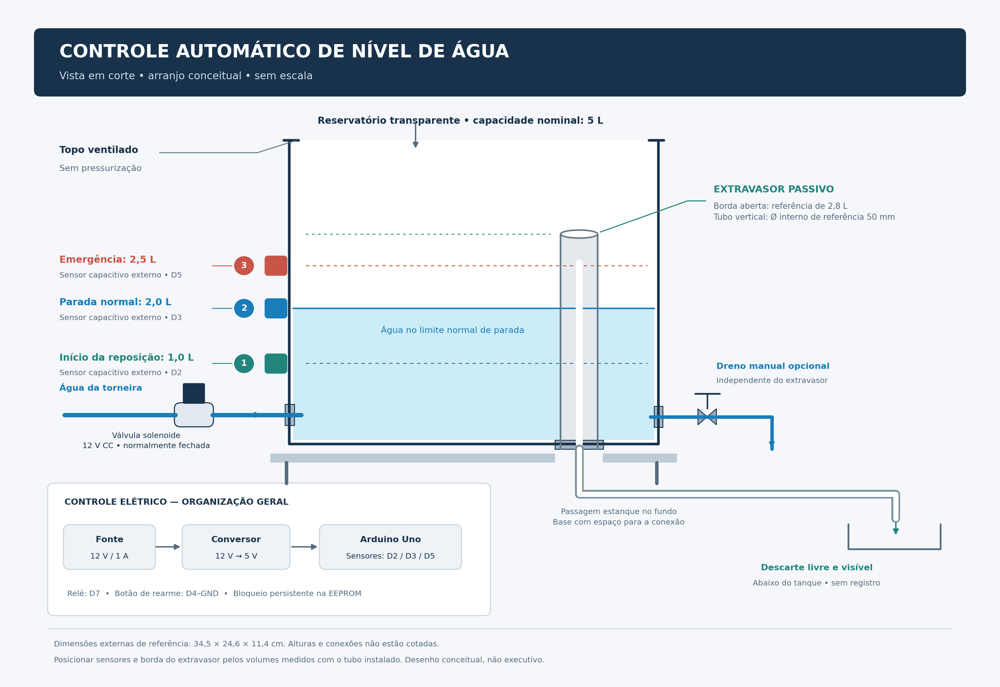

# Sistema de Controle Automático de Nível de Água com Arduino

Protótipo de automação para reposição de água em um reservatório, com três sensores de nível, válvula solenoide, bloqueio persistente e rearme manual.

**Status:** lógica verificada em simulação C++ e modelo hidráulico preliminar. A compilação para Arduino Uno e os testes físicos ainda estão pendentes. Este projeto não é um sistema de segurança certificado.



O desenho é conceitual: os volumes indicam referências de operação, sem definir alturas de montagem. Calibre os níveis no recipiente real, com o extravasor instalado.

## Funcionamento

A reposição começa abaixo do sensor inferior e termina ao atingir o superior. O sensor de emergência desliga o comando e bloqueia novas tentativas. Excesso de tempo ou sinais incompatíveis também provocam bloqueio, registrado na EEPROM e mantido após desligamento. O rearme depende de nova pressão do botão, emergência inativa e sinais coerentes.

| Função | Referência | Pino |
|---|---:|---|
| Iniciar reposição | 1 L | D2 |
| Encerrar reposição | 2 L | D3 |
| Emergência | 2,5 L | D5 |
| Botão de rearme | Normalmente aberto | D4 e GND |
| Comando do relé | Ativo em HIGH | D7 |
| Indicador de bloqueio | LED integrado | D13 |
| Borda do extravasor vertical aberto | 2,8 L | Sem comando elétrico |

Os sensores são ativos em LOW. Os volumes dependem da posição física dos sensores; o Arduino recebe sinais digitais e não mede litros diretamente. A supervisão usa 35 segundos por etapa, sob a premissa de ganho líquido mínimo de 2 L/min.

## Componentes de referência

- Arduino Uno R3 (ATmega328P).
- Três sensores capacitivos SEN0485.
- Módulo relé DFR0017 com comando ativo em HIGH.
- Válvula solenoide normalmente fechada de 12 V CC.
- Botão momentâneo, resistor de 10 kΩ e diodo 1N4001.
- Fonte isolada de 12 V e conversor regulado de 5 V, a confirmar conforme os consumos reais.
- Reservatório nominal de 5 L, dreno manual e extravasor vertical aberto de referência de 50 mm internos.

Confira alimentação, polaridade, montagem e limitações no [guia de montagem](LEIAME.md). A válvula é alimentada pelos contatos do relé; nunca por um pino do Arduino.

## Abrir no Arduino IDE

1. Baixe ou clone este repositório.
2. Abra [ControleNivel/ControleNivel.ino](ControleNivel/ControleNivel.ino).
3. Selecione Arduino Uno e a porta correspondente.
4. Compile antes de carregar; a compilação AVR ainda não foi validada neste projeto.

A biblioteca EEPROM faz parte do pacote Arduino AVR Boards. O Monitor Serial usa 9600 baud.

## Repetir as simulações

Requer g++ com suporte a C++11 e Python 3. Execute na raiz do repositório:

```bash
g++ -std=c++11 -Wall -Wextra -Werror -fsanitize=undefined -Itests tests/test.cpp -o teste_logica
./teste_logica
g++ -std=c++11 -Wall -Wextra -Werror -fsanitize=undefined -Itests tests/physical.cpp -o teste_tanque
./teste_tanque
python3 tests/teste_extravasor.py
```

As funções Arduino e a EEPROM são simuladas. Os ensaios cobrem lógica de estados, temporização, rearme, persistência simulada, cenários de enchimento e hipóteses de extravasão. Veja as premissas e os resultados no [relatório de simulação](RESULTADOS_SIMULACAO.md).

## Limitações e próximas validações

- Medir volume real até a borda, posições dos sensores e espaço para conexões.
- Compilar para o Uno e testar entradas, relé, partida, emergência e rearme na placa.
- Medir vazão, atraso da válvula e capacidade real do extravasor, incluindo as perdas do percurso.
- Confirmar dimensionamento elétrico, vedação e suporte mecânico.
- O sensor inferior travado indicando água pode impedir reposição sem gerar alarme.
- O sensor de emergência compartilha Arduino e relé; não constitui proteção elétrica independente.
- Válvula travada aberta e extravasor obstruído podem causar transbordamento.
- A persistência em EEPROM não foi validada contra perda de energia durante a escrita.

O modelo assume 5 L até a borda, entrada de até 12 L/min e condução do extravasor de pelo menos 18 L/min. Esses valores não representam medições da montagem. Os resultados hidráulicos não aprovam a instalação física.

## Documentação

- [Descrição do projeto](DESCRICAO_PROJETO.md)
- [Ligações e instruções](LEIAME.md)
- [Resultados e hipóteses da simulação](RESULTADOS_SIMULACAO.md)
- [Desenho conceitual](docs/Desenho_Conceitual_Controle_Nivel.png)

Autor: Enzo Castro Cordovil.
