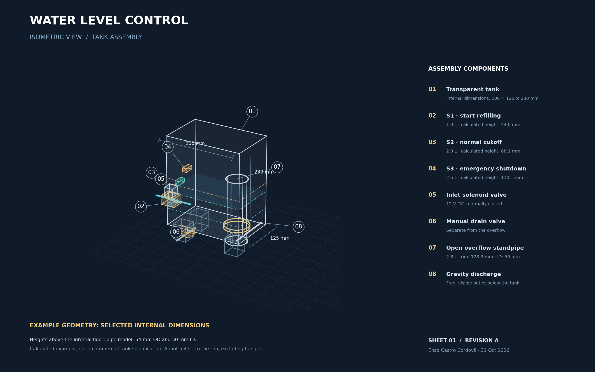
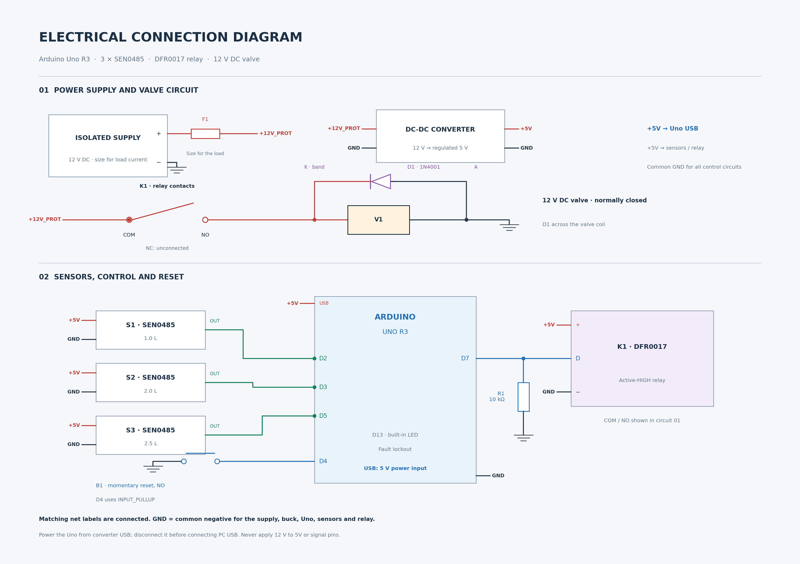

# Automatic water level control with Arduino

[English](README.md) | [Português](README.pt-BR.md)

An Arduino Uno manages tank refilling using three capacitive level sensors. A solenoid valve controls the water inlet while the program monitors the level signals and filling time. When a fault is detected, the controller switches off the valve command and keeps the system locked until a manual reset.

[](https://github.com/EnzoCastro-neko/controle-nivel-agua-arduino/raw/refs/heads/main/docs/en/Vista_3D_Conceitual.png)

[Open the full-resolution 3D drawing](https://github.com/EnzoCastro-neko/controle-nivel-agua-arduino/raw/refs/heads/main/docs/en/Vista_3D_Conceitual.png) · [SVG drawing](docs/en/Vista_3D_Conceitual.svg)

The example tank has internal dimensions of 200 × 125 × 230 mm. The overflow standpipe has an internal diameter of 50 mm and an external diameter of 54 mm. The level calculations account for the space occupied by the pipe, excluding flanges and other internal fittings.

| Reference | Water volume | Calculated height above the internal tank floor |
|---|---:|---:|
| Lower sensor | 1.0 L | 44.0 mm |
| Upper sensor | 2.0 L | 88.1 mm |
| Emergency sensor | 2.5 L | 110.1 mm |
| Overflow standpipe rim | 2.8 L | 123.3 mm |

The calculated net capacity is approximately 5.47 L. The calculations use a 5 L limit to leave a margin below the tank rim. Drawings are available in PNG and SVG formats.

## Electrical connections

[](https://github.com/EnzoCastro-neko/controle-nivel-agua-arduino/raw/refs/heads/main/docs/en/Diagrama_Eletrico.png)

[Open the full-resolution wiring diagram](https://github.com/EnzoCastro-neko/controle-nivel-agua-arduino/raw/refs/heads/main/docs/en/Diagrama_Eletrico.png) · [SVG drawing](docs/en/Diagrama_Eletrico.svg)

Points with the same net label, such as `+5V`, `+12V_PROT`, or `GND`, are connected. The diagram identifies component functions and terminals; check the labels on the actual boards when wiring them. The [calculations and connection table](docs/en/GEOMETRY_AND_WIRING.md) provide the assembly details.

## How it works

Refilling starts when the water drops below the lower sensor and stops when it reaches the upper sensor. If the emergency sensor detects water, the program switches off the valve command and locks out further filling. A filling timeout or inconsistent sensor signals also trigger a lockout.

The lockout is stored in EEPROM and survives a power cycle. To reset it, release and press the reset button again while the emergency sensor is inactive and the level signals are consistent.

| Function | Reference | Pin |
|---|---:|---|
| Start refilling | 1 L | D2 |
| Stop refilling | 2 L | D3 |
| Emergency shutdown | 2.5 L | D5 |
| Manual reset button | Normally open | D4 to GND |
| Relay control | Active HIGH | D7 |
| Fault indicator | Built-in LED | D13 |
| Overflow standpipe rim | 2.8 L | Passive hydraulic outlet |

The sensors output LOW when they detect water. Their mounting positions set the reference volumes; the Arduino reads digital signals. Each filling stage has a 35-second timeout, calculated for a minimum net inflow of 2 L/min.

## Reference components

- Arduino Uno R3 (ATmega328P).
- Three SEN0485 capacitive level sensors.
- DFR0017 relay module with active-HIGH control.
- Normally closed 12 V DC solenoid valve.
- Momentary push button, 10 kΩ resistor, and 1N4001 diode.
- Isolated 12 V power supply and regulated 5 V converter, sized for the actual load.
- Example rectangular tank, manual drain, and open overflow standpipe with a reference internal diameter of 50 mm.

The [assembly guide](docs/en/ASSEMBLY.md) covers power, polarity, and wiring. The valve receives power through the relay contacts, never from an Arduino pin.

## Open in Arduino IDE

1. Download or clone this repository.
2. Open [ControleNivel/ControleNivel.ino](ControleNivel/ControleNivel.ino).
3. Select Arduino Uno and the appropriate port.
4. Compile the sketch and upload it to the board.

The EEPROM library is included with Arduino AVR Boards. Set the Serial Monitor to 9600 baud.

## Run the simulations

You need g++ with C++11 support and Python 3. Run these commands from the repository root:

```bash
g++ -std=c++11 -Wall -Wextra -Werror -fsanitize=undefined -Itests tests/test.cpp -o teste_logica
./teste_logica
g++ -std=c++11 -Wall -Wextra -Werror -fsanitize=undefined -Itests tests/physical.cpp -o teste_tanque
./teste_tanque
python3 tests/teste_extravasor.py
python3 tests/teste_geometria_exemplo.py
```

The tests run the sketch with simulated Arduino functions and EEPROM. They check state transitions, filling timeouts, manual reset, and lockout persistence after a restart. The [simulation report](docs/en/SIMULATION_RESULTS.md) describes filling and overflow scenarios and the assumptions used in each calculation.

## Design parameters

| Parameter | Design value |
|---|---:|
| Internal dimensions of the example tank | 200 × 125 × 230 mm |
| Operating volume range | 1 to 2 L |
| Emergency level | 2.5 L |
| Overflow onset | 2.8 L |
| Maximum inlet flow in the model | 12 L/min |
| Minimum net inflow for the timeouts | 2 L/min |
| Timeout per filling stage | 35 s |
| Overflow standpipe internal diameter | 50 mm |

The calculation notes explain the geometric and hydraulic assumptions. The [simulation report](docs/en/SIMULATION_RESULTS.md) records the scenarios and the controller's response under each condition.

## Technical documentation

English technical documents and vector drawings:

- [Project description](docs/en/PROJECT.md)
- [Wiring and assembly instructions](docs/en/ASSEMBLY.md)
- [Simulation results and assumptions](docs/en/SIMULATION_RESULTS.md)
- [3D drawing in SVG format](docs/en/Vista_3D_Conceitual.svg)
- [Electrical diagram in SVG format](docs/en/Diagrama_Eletrico.svg)
- [Example geometry and connection table](docs/en/GEOMETRY_AND_WIRING.md)
- [Earlier cross-section sketch without dimensions (Portuguese)](docs/Desenho_Conceitual_Controle_Nivel.png)

Author: Enzo Castro Cordovil.

## Engineering verification

- [Electrical design and component selection](docs/en/ELECTRICAL_DESIGN.md)
- [Verification record and scope](docs/en/ENGINEERING_VERIFICATION.md)
- [Recorded simulation output](docs/evidencias/simulacao.txt)

Run `bash tests/run_checks.sh` to reproduce the recorded software and hydraulic checks. An Arduino Uno compilation workflow is prepared in `.github/workflows/verify.yml`; AVR compilation is only established after a successful run.
