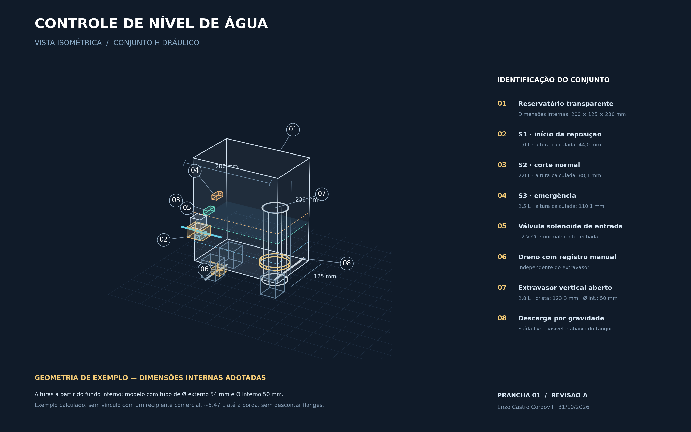
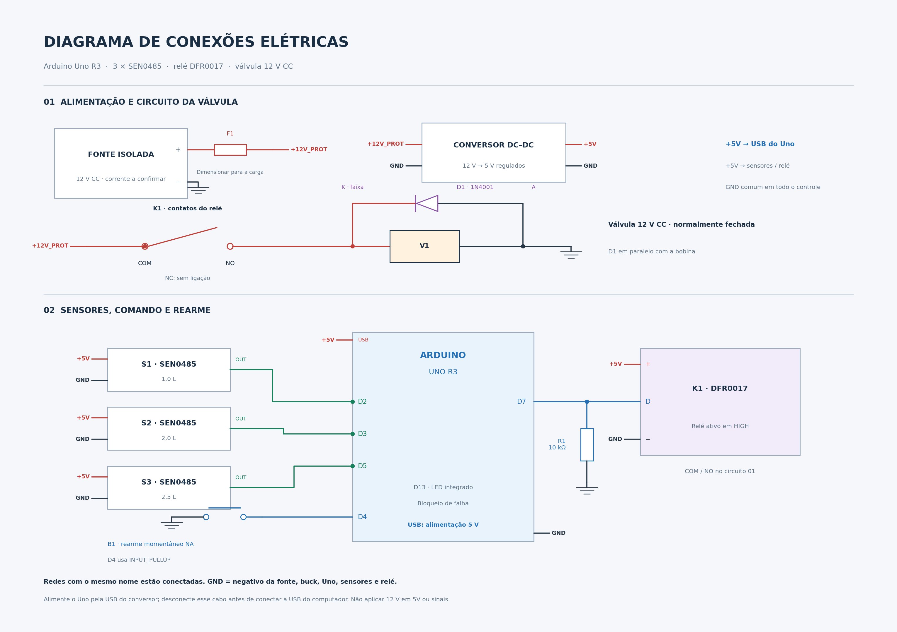

# Controle automático de nível de água com Arduino

[English](README.md) | [Português](README.pt-BR.md)

O Arduino Uno controla a reposição de água no tanque a partir de três sensores capacitivos. Uma válvula solenoide abre a entrada de água, enquanto o programa acompanha os níveis e o tempo de enchimento. Em caso de falha, o sistema fecha a válvula e mantém o bloqueio até o rearme manual.

[](https://github.com/EnzoCastro-neko/controle-nivel-agua-arduino/raw/refs/heads/main/docs/Vista_3D_Conceitual.png)

[Abrir vista 3D em tamanho original](https://github.com/EnzoCastro-neko/controle-nivel-agua-arduino/raw/refs/heads/main/docs/Vista_3D_Conceitual.png) · [Arquivo vetorial SVG](docs/Vista_3D_Conceitual.svg)

O tanque de exemplo tem dimensões internas de 200 × 125 × 230 mm. O tubo extravasor tem 50 mm de diâmetro interno e 54 mm de diâmetro externo. O cálculo das alturas desconta o espaço ocupado pelo tubo, sem incluir flanges e outras conexões internas.

| Referência | Volume | Altura calculada a partir do fundo interno |
|---|---:|---:|
| Sensor inferior | 1,0 L | 44,0 mm |
| Sensor superior | 2,0 L | 88,1 mm |
| Emergência | 2,5 L | 110,1 mm |
| Borda do extravasor | 2,8 L | 123,3 mm |

A capacidade líquida calculada é de aproximadamente 5,47 L. Os cálculos usam 5 L como limite, deixando uma margem abaixo da borda. Os desenhos estão disponíveis em PNG e SVG.

## Conexões elétricas

[](https://github.com/EnzoCastro-neko/controle-nivel-agua-arduino/raw/refs/heads/main/docs/Diagrama_Eletrico.png)

[Abrir diagrama elétrico em tamanho original](https://github.com/EnzoCastro-neko/controle-nivel-agua-arduino/raw/refs/heads/main/docs/Diagrama_Eletrico.png) · [Arquivo vetorial SVG](docs/Diagrama_Eletrico.svg)

Pontos com o mesmo rótulo, como `+5V`, `+12V_PROT` ou `GND`, estão ligados entre si. O desenho identifica as funções e os terminais de cada componente; a posição dos conectores deve ser conferida na placa. A [memória de cálculo e a tabela de ligações](docs/GEOMETRIA_E_CONEXOES.md) trazem os detalhes da montagem.

## Funcionamento

A reposição começa quando a água baixa do sensor inferior e termina ao alcançar o superior. Se a água atingir o sensor de emergência, o programa desliga o comando da válvula e bloqueia o enchimento. O mesmo acontece se o prazo for excedido ou os sensores apresentarem sinais incompatíveis.

O bloqueio fica gravado na EEPROM e permanece após desligar a alimentação. Para rearmar, é preciso soltar e pressionar o botão novamente, com a emergência inativa e os sinais dos sensores coerentes.

| Função | Referência | Pino |
|---|---:|---|
| Iniciar reposição | 1 L | D2 |
| Encerrar reposição | 2 L | D3 |
| Emergência | 2,5 L | D5 |
| Botão de rearme | Normalmente aberto | D4 e GND |
| Comando do relé | Ativo em HIGH | D7 |
| Indicador de bloqueio | LED integrado | D13 |
| Borda do extravasor vertical aberto | 2,8 L | Sem comando elétrico |

Os sensores enviam LOW quando detectam água. A posição de cada sensor define o volume de referência; o Arduino recebe esse sinal digital. O programa acompanha cada etapa por até 35 segundos, calculados para um ganho líquido mínimo de 2 L/min.

## Componentes de referência

- Arduino Uno R3 (ATmega328P).
- Três sensores capacitivos SEN0485.
- Módulo relé DFR0017 com comando ativo em HIGH.
- Válvula solenoide normalmente fechada de 12 V CC.
- Botão momentâneo, resistor de 10 kΩ e diodo 1N4001.
- Fonte isolada de 12 V e conversor regulado de 5 V, a confirmar conforme os consumos reais.
- Reservatório retangular de exemplo, dreno manual e extravasor vertical aberto de referência de 50 mm internos.

Confira alimentação, polaridade e montagem no [guia de montagem](LEIAME.md). A válvula é alimentada pelos contatos do relé; nunca por um pino do Arduino.

## Abrir no Arduino IDE

1. Baixe ou clone este repositório.
2. Abra [ControleNivel/ControleNivel.ino](ControleNivel/ControleNivel.ino).
3. Selecione Arduino Uno e a porta correspondente.
4. Compile o código e carregue na placa.

A biblioteca EEPROM acompanha o pacote Arduino AVR Boards. Configure o Monitor Serial para 9600 baud.

## Repetir as simulações

Requer g++ com suporte a C++11 e Python 3. Execute na raiz do repositório:

```bash
g++ -std=c++11 -Wall -Wextra -Werror -fsanitize=undefined -Itests tests/test.cpp -o teste_logica
./teste_logica
g++ -std=c++11 -Wall -Wextra -Werror -fsanitize=undefined -Itests tests/physical.cpp -o teste_tanque
./teste_tanque
python3 tests/teste_extravasor.py
python3 tests/teste_geometria_exemplo.py
```

Os testes executam o código com funções Arduino e EEPROM simuladas. Eles verificam as mudanças de estado, os prazos de enchimento e o rearme, além da permanência do bloqueio após reinicialização. Os cenários de enchimento e extravasão estão descritos no [relatório de simulação](RESULTADOS_SIMULACAO.md), com as hipóteses usadas em cada cálculo.

## Parâmetros de dimensionamento

| Parâmetro | Valor adotado |
|---|---:|
| Dimensões internas do tanque de exemplo | 200 × 125 × 230 mm |
| Volume de operação | 1 a 2 L |
| Nível de emergência | 2,5 L |
| Início de extravasão | 2,8 L |
| Vazão máxima de entrada no modelo | 12 L/min |
| Ganho líquido mínimo para os prazos | 2 L/min |
| Supervisão por etapa | 35 s |
| Diâmetro interno do extravasor | 50 mm |

A memória de cálculo apresenta as hipóteses geométricas e hidráulicas adotadas. O [relatório de simulação](RESULTADOS_SIMULACAO.md) reúne os cenários analisados e o comportamento do sistema em cada condição.

## Documentação

- [Descrição do projeto](DESCRICAO_PROJETO.md)
- [Ligações e instruções](LEIAME.md)
- [Resultados e hipóteses da simulação](RESULTADOS_SIMULACAO.md)
- [Vista 3D em SVG](docs/Vista_3D_Conceitual.svg)
- [Esquema elétrico em SVG](docs/Diagrama_Eletrico.svg)
- [Geometria de exemplo e ligações](docs/GEOMETRIA_E_CONEXOES.md)
- [Esboço anterior em corte — sem cotas](docs/Desenho_Conceitual_Controle_Nivel.png)

Autor: Enzo Castro Cordovil.

## Verificação de engenharia

- [Dimensionamento elétrico e componentes](docs/DIMENSIONAMENTO_ELETRICO.md)
- [Registro de verificação e alcance dos resultados](docs/VERIFICACAO_ENGENHARIA.md)
- [Saída registrada da simulação](docs/evidencias/simulacao.txt)

Execute `bash tests/run_checks.sh` para reproduzir os ensaios de software e hidráulica. A [compilação para Arduino Uno e as simulações passaram](https://github.com/EnzoCastro-neko/controle-nivel-agua-arduino/actions/runs/41200581064), com Arduino CLI 1.2.2 e Arduino AVR Boards 1.8.6. O firmware usa 3.928 bytes de programa e 387 bytes de RAM estática. Consulte o [log de compilação](docs/evidencias/compilacao_uno.txt).
