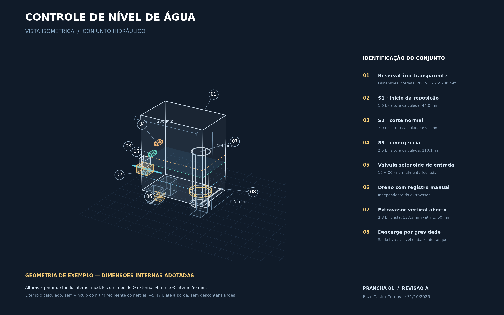
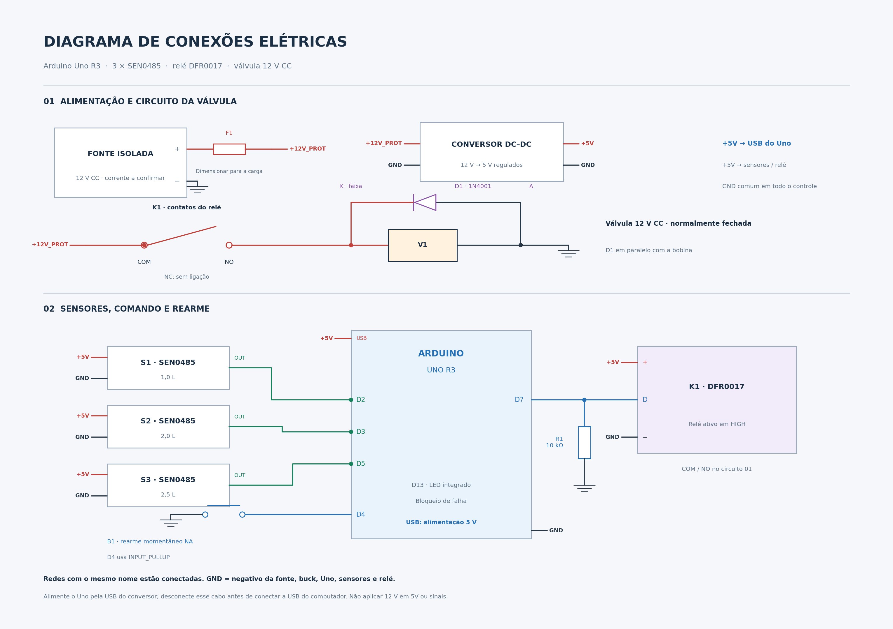

# Geometria de exemplo e conexões elétricas

As dimensões foram escolhidas para ilustrar e calcular o projeto. Não são medições de um recipiente existente. As pranchas têm aparência de desenho CAD, em PNG e SVG; não constituem arquivo AutoCAD DWG nem desenho de fabricação aprovado.

## Vista 3D

Reservatório aberto e ventilado com dimensões **internas de 200 × 125 × 230 mm**. Paredes planas, material não metálico compatível com água e espessura compatível com o sensor (alcance especificado de 3 mm). A espessura estrutural não foi dimensionada; não se presume que uma parede de determinada espessura suporte a carga só por atender ao sensor.

O tubo extravasor do exemplo tem 50 mm internos e 54 mm externos. Esses valores são hipóteses geométricas, não uma equivalência automática a uma bitola comercial. A crista é horizontal e aberta, com passagem estanque no fundo e descarga livre abaixo do tanque. Flanges, suportes e curvas devem caber na montagem real.

Área interna: `A = 0,200 × 0,125 = 0,025 m²`.

Área ocupada pelo tubo abaixo da crista: `At = π × 0,054² / 4 = 0,002290221 m²`.

Até 2,8 L: `h = V / (A − At)`. Acima da crista: `h = h_crista + (V − 0,0028) / A`. O interior do tubo permanece drenado no cálculo estático; o deslocamento usa o diâmetro externo, incluindo esse espaço que não armazena água no reservatório.

| Função | Volume | Altura acima do fundo interno |
|---|---:|---:|
| S1 — inferior | 1,0 L | 44,0 mm |
| S2 — superior | 2,0 L | 88,1 mm |
| S3 — emergência | 2,5 L | 110,1 mm |
| Crista do extravasor | 2,8 L | 123,3 mm |
| Limite conservador de cálculo | 5,0 L | 211,3 mm |
| Borda geométrica | ~5,47 L | 230,0 mm |

As alturas referem-se ao ponto de detecção, não ao centro de um furo. Os sensores são externos. Os corpos de S2 e S3 podem ser deslocados horizontalmente para evitar sobreposição; conferir interferência entre sensores e tubo. A crista fica acima de S3. A posição lateral de entrada, dreno e passagem de fundo no desenho é ilustrativa, sem gabarito de furação.

O volume bruto é 5,75 L; o tubo desloca aproximadamente 0,282 L até a crista. A capacidade geométrica líquida resulta em 5,468 L, sem descontar flanges ou outras peças internas. A nova geometria mantém os volumes de operação e os prazos do código. Na montagem, recalibrar com água e todas as conexões instaladas.

No modelo de vertedor circular, `Q = (2/3) Cd π D √(2g) H^(3/2)`. Com 12 L/min, `Cd=0,4` e condução assumida de pelo menos 18 L/min, o equilíbrio do exemplo é aproximadamente 3,063 L. Na sensibilidade de `Cd=0,2 a 0,6`, o maior equilíbrio é 3,217 L. São previsões ideais; não demonstram capacidade de uma tubulação real ou funcionamento universal.

Execute `python3 tests/teste_geometria_exemplo.py` a partir da raiz. O teste hidráulico anterior foi preservado como análise das geometrias históricas; os ensaios dinâmicos em `tests/physical.cpp` usam agora a área interna de 0,025 m² acima da crista.

## Esquema elétrico

Os rótulos de rede indicam conexões comuns. `GND` é o negativo CC comum da fonte, conversor, Arduino, sensores e módulo relé; não significa terra de proteção da rede elétrica. A posição de bornes nos blocos não reproduz a disposição física de cada placa. Usar as identificações impressas no hardware.

| Origem | Destino | Observação |
|---|---|---|
| Fonte +12 V | F1 → rede +12V_PROT | F1 a dimensionar conforme válvula, conversor e cabos |
| +12V_PROT | COM do relé e entrada positiva do conversor | Ramos em paralelo |
| Fonte negativa | GND comum | Inclui entrada/saída negativa do buck |
| Conversor +5 V | VCC dos três sensores, + do relé e alimentação USB do Uno | Distribuição em paralelo; corrente a dimensionar |
| Sensor S1 OUT (verde) | D2 | Inferior; ativo em LOW |
| Sensor S2 OUT (verde) | D3 | Superior; ativo em LOW |
| Sensor S3 OUT (verde) | D5 | Emergência; ativo em LOW |
| Sensores VCC (vermelho) | +5 V | Todos os sensores |
| Sensores GND (preto) | GND | Todos os sensores |
| D7 | Terminal D do módulo relé | HIGH aciona o relé de referência |
| D7 | R1 de 10 kΩ → GND | Mantém comando baixo durante a partida |
| D4 | Botão NA → GND | INPUT_PULLUP no programa |
| NO do relé | Positivo da bobina da válvula | Válvula normalmente fechada, 12 V CC |
| Negativo da bobina | GND | Retorno de potência |
| D1 cátodo (faixa) | Positivo da bobina após NO | Diodo em antiparalelo |
| D1 ânodo | Negativo da bobina | 1N4001 de referência; conferir adequação à válvula |
| NC do relé | Sem conexão | Não confundir com válvula hidráulica normalmente fechada |

Arduino alimentado por USB a partir de uma saída regulada de 5 V com conexão apropriada; não alimentar simultaneamente pela USB do conversor e do computador. Desconectar o cabo de alimentação do conversor antes de ligar a USB do PC. O esquema não injeta 12 V no pino 5V, em sinais ou na USB. Alimentação e proteção contra sobrecorrente precisam ser confirmadas conforme o hardware escolhido. A entrada de rede CA da fonte isolada fica fora do esquema.

O terceiro sensor usa o mesmo Arduino e relé e não é um circuito de segurança independente. O diagrama não elimina as limitações descritas no relatório, incluindo válvula presa, sensor inferior travado e extravasor obstruído.

## Fontes de pinagem

- [DFRobot SEN0485 — alimentação, fios e saída digital](https://wiki.dfrobot.com/sen0485).
- [DFRobot DFR0017 — terminais de controle e contatos](https://wiki.dfrobot.com/dfr0017/).

## Arquivos editáveis e reprodução

- [Vista 3D em SVG](Vista_3D_Conceitual.svg).
- [Diagrama elétrico em SVG](Diagrama_Eletrico.svg).
- `python3 docs/gerar_diagramas.py` gera as imagens com Python, NumPy e Matplotlib.

Os arquivos SVG são desenhos vetoriais. A vista é uma projeção 3D ilustrativa, sem um sólido paramétrico de CAD ou formato DWG.
