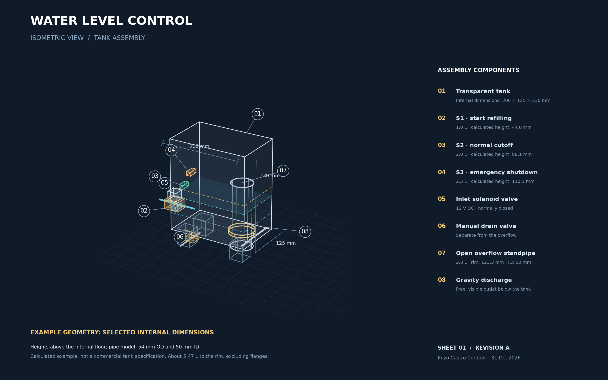
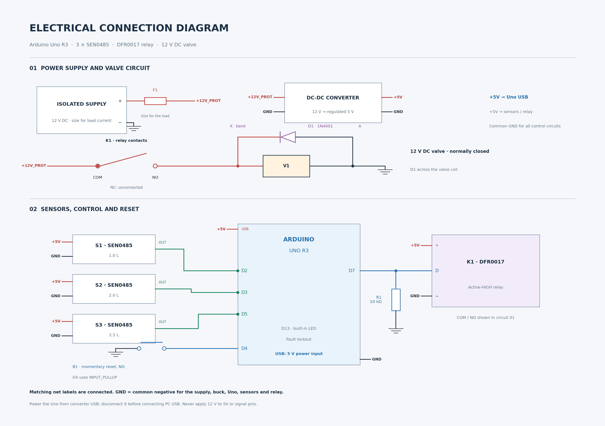

# Example geometry and electrical connections

[English](GEOMETRY_AND_WIRING.md) | [Português](../GEOMETRIA_E_CONEXOES.md)

The dimensions in this example were selected for the calculations and assembly drawing. The sheets are available in PNG and SVG with a CAD-style appearance. They are technical illustrations without a DWG model or manufacturing detail drawings.

## 3D view

[Open the full-resolution 3D view](https://github.com/EnzoCastro-neko/controle-nivel-agua-arduino/raw/refs/heads/main/docs/en/Vista_3D_Conceitual.png)

The tank is open and vented, with internal dimensions of 200 × 125 × 230 mm. Its walls should be flat, non-metallic, compatible with water, and thin enough for the sensor's 3 mm sensing distance. Wall strength needs separate structural sizing; satisfying the sensing-distance requirement does not establish that a wall can carry the water load.

The example overflow pipe has a 50 mm internal diameter and a 54 mm external diameter. Check both dimensions when selecting a commercial pipe. The upper rim is horizontal and open. Discharge passes through a sealed bottom fitting and ends freely below the tank. Leave room for flanges, supports, and bends.

Internal area: `A = 0.200 × 0.125 = 0.025 m²`.

Area occupied by the pipe below the rim: `At = π × 0.054² / 4 = 0.002290221 m²`.

Up to 2.8 L: `h = V / (A − At)`. Above the overflow rim: `h = h_crista + (V − 0.0028) / A`. In the static calculation, the pipe's interior remains drained. Displacement therefore uses the external diameter, including that interior space which does not store tank water. Use metres and cubic metres in these equations; `h_crista` is the standpipe rim height.

| Function | Volume | Height above the internal tank floor |
|---|---:|---:|
| S1 lower sensor | 1.0 L | 44.0 mm |
| S2 upper sensor | 2.0 L | 88.1 mm |
| S3 emergency sensor | 2.5 L | 110.1 mm |
| Overflow rim | 2.8 L | 123.3 mm |
| Conservative calculation limit | 5.0 L | 211.3 mm |
| Tank rim | Approximately 5.47 L | 230.0 mm |

The heights identify the sensing points of the externally mounted sensors. S2 and S3 can be offset horizontally to prevent their bodies from overlapping; also check interference with the pipe. The overflow rim is above S3. The lateral positions of the inlet, drain, and bottom fitting are illustrative and do not define a drilling template.

Gross volume is 5.75 L, and the pipe displaces approximately 0.282 L up to its rim. The resulting net geometric capacity is 5.468 L, excluding flanges and other internal parts. This geometry retains the operating volumes and code timeouts. Recalibrate using water after all fittings are installed.

The circular-weir model uses `Q = (2/3) Cd π D √(2g) H^(3/2)`. At 12 L/min, `Cd=0.4`, and assumed pipe discharge capacity of at least 18 L/min, equilibrium is approximately 3.063 L. For `Cd=0.2 to 0.6`, the highest equilibrium is 3.217 L. These ideal predictions do not establish the capacity of actual pipework or operation under every condition.

Run `python3 tests/teste_geometria_exemplo.py` from the repository root. The earlier hydraulic test remains available for the historical geometries. Dynamic tests in `tests/physical.cpp` use an internal area of 0.025 m² above the overflow rim.

## Electrical diagram

[Open the full-resolution electrical diagram](https://github.com/EnzoCastro-neko/controle-nivel-agua-arduino/raw/refs/heads/main/docs/en/Diagrama_Eletrico.png)

Points with the same net label are connected. `GND` is the common DC negative for the power supply, converter, Arduino, sensors, and relay module. It is not mains protective earth. Locate terminals using the labels printed on the hardware; the diagram blocks identify functions without reproducing the physical layout of each board.

| Source | Destination | Note |
|---|---|---|
| Supply +12 V | F1 to +12V_PROT net | Size F1 for the valve, converter, and wiring |
| +12V_PROT | Relay COM and converter positive input | Parallel branches |
| Supply negative | Common GND | Includes buck input and output negative |
| Converter +5 V | Three sensor VCC terminals, relay +, and Uno USB power | Parallel distribution; size for load current |
| Sensor S1 OUT (green) | D2 | Lower sensor; active LOW |
| Sensor S2 OUT (green) | D3 | Upper sensor; active LOW |
| Sensor S3 OUT (green) | D5 | Emergency sensor; active LOW |
| Sensor VCC (red) | +5 V | All sensors |
| Sensor GND (black) | GND | All sensors |
| D7 | Relay module terminal D | HIGH activates the reference relay |
| D7 | R1, 10 kΩ, to GND | Keeps the command low during startup |
| D4 | Normally open button to GND | INPUT_PULLUP in the sketch |
| Relay NO | Valve coil positive | Normally closed 12 V DC valve |
| Coil negative | GND | Power return |
| D1 cathode (band) | Coil positive after NO | Flyback diode across the coil |
| D1 anode | Coil negative | Reference 1N4001; check suitability for the valve |
| Relay NC | Unconnected | Separate from the valve's normally closed hydraulic state |

The Arduino receives regulated 5 V through USB using a suitable cable and connection. Disconnect converter power before connecting the computer's USB cable. Do not use both USB supplies at once or apply 12 V to the 5V pin, signal pins, or USB. Size power and overcurrent protection for the selected hardware. The diagram starts at the isolated supply's DC output; mains AC input wiring is outside its scope.

The third sensor shares the Arduino and relay and is not an independent safety circuit. The limitations in the report still apply, including a stuck valve, a stuck lower sensor, and a blocked overflow.

## Pinout sources

- [DFRobot SEN0485: power, wire colors, and digital output](https://wiki.dfrobot.com/sen0485).
- [DFRobot DFR0017: control terminals and relay contacts](https://wiki.dfrobot.com/dfr0017/).

## Editable drawings and reproduction

- [3D view in SVG format](Vista_3D_Conceitual.svg).
- [Electrical diagram in SVG format](Diagrama_Eletrico.svg).
- Run `python3 docs/gerar_diagramas_en.py` to generate the English drawings with Python, NumPy, and Matplotlib.
- Run `python3 docs/gerar_diagramas.py` to generate the Portuguese drawings.

SVG files are vector drawings. The 3D view is an illustrative projection without a parametric CAD solid or DWG file.
